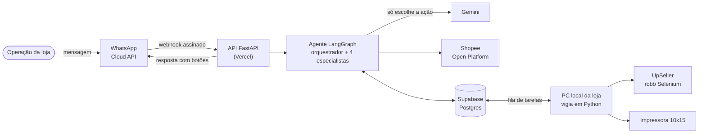

# Agente de IA que opera uma loja da Shopee pelo WhatsApp

**Estudo de caso** de um agente multi-agente (LangGraph + Gemini) em produção numa loja de
semijoias. Pelo WhatsApp, a equipe emite as notas fiscais, organiza os envios, imprime as
etiquetas, controla o estoque real e consulta vendas, lucro e a saúde da loja. Toda ação que muda
algo no mundo real pede confirmação antes de acontecer.

> O código é privado porque o sistema está em uso numa loja real. Ele pode ser apresentado numa
> avaliação técnica. Este repositório reúne o problema, a arquitetura, as decisões e os resultados.

## O problema

Uma loja pequena da Shopee repete as mesmas tarefas todo dia, em três sistemas diferentes:

- **Notas fiscais** no emissor (UpSeller), que não tem API.
- **Envio e etiquetas** no painel da Shopee, depois que cada nota sobe, mais a impressão numa térmica 10x15.
- **Acompanhamento**: vendas, lucro, carteira, anúncios e estoque. A Shopee não controla o
  estoque físico (um kit usa várias peças, e o estoque do anúncio não é o da prateleira).

Cada tarefa exige abrir um painel, filtrar, clicar e conferir. O objetivo foi trocar isso por
mensagens em português do dia a dia, **sem abrir mão da segurança**.

## Como fica no dia a dia

Exemplo de uma rodada real de trabalho (números ilustrativos):

```text
Operação: emitir
Agente:   Emitir notas fiscais da Shopee de 5 pedido(s)?   [Sim] [Não]
Operação: [Sim]
Agente:   Nota(s) na fila, aguarde alguns instantes.
          ... o PC da loja emite as notas, o agente confere na Shopee ...
Agente:   Notas emitidas: 5 de 5. Já pode organizar o envio.   [Organizar envio]
Operação: [Organizar envio]
Agente:   Organizar o envio de 5 pedido(s)?   [Sim] [Não]
Operação: [Sim]
Agente:   Envio organizado de 5 pedido(s). Aviso aqui quando as etiquetas estiverem prontas para imprimir.
          ... minutos depois, quando a Shopee libera ...
Agente:   Etiquetas de 5 pedido(s) prontas para imprimir.   [Imprimir]
Operação: [Imprimir]
Agente:   Confirmar impressão da etiqueta de 5 pedido(s)?   [Sim] [Não]
Operação: [Sim]
Agente:   Processando... Aguarde alguns instantes.
          ... a etiqueta sai na térmica da loja ...
Agente:   Etiquetas impressas: 5.
```

O mesmo vale para perguntas livres: "quanto vendi em outubro?", "o que está acabando no
estoque?", "contei 40 trio ouro", "zera o BTCFBP na Shopee", "qual o lucro do mês?".

## Arquitetura



Desenhos completos (C4 em três níveis, quatro diagramas de sequência, contrato das 17
ferramentas, riscos e medidas) em [docs/documento_de_arquitetura.md](docs/documento_de_arquitetura.md).

## Decisões de engenharia

As 12 decisões, com alternativas e consequências, estão em [docs/decisoes.md](docs/decisoes.md).
As principais:

1. **A IA só escolhe a ação, nunca escreve a resposta.** Cada ferramenta devolve o texto final a
   partir de modelos fixos. A resposta é sempre verdadeira e testável, e o pior erro possível da
   IA passa a ser escolher a ferramenta errada.
2. **Confirmação humana sobre o que foi mostrado.** Ações reais pausam o grafo (`interrupt` do
   LangGraph) com a lista do que vai mudar. O "sim" executa só sobre essa lista. Se chegou pedido
   novo no meio, o agente pergunta de novo.
3. **Especialista obrigado a chamar ferramenta** (`tool_choice="any"`). Veio de um incidente
   real: o modelo "respondeu" um pedido copiando um erro antigo da conversa, sem executar nada.
4. **Orquestrador + especialistas.** Cada especialista vê só as ferramentas da sua área. Ferramentas
   parecidas deixam de se confundir, e o orquestrador usa um modelo mais leve.
5. **Escada antes da IA e aprendizado automático.** Comandos, botões e atalhos são resolvidos sem
   IA. Uma frase que a IA entendeu 5 vezes, em 3 dias, sempre com a mesma ação, vira atalho sozinha.
6. **PC local para o que não tem API.** O emissor de notas recusa login vindo de servidores, e a
   impressora é física. Um vigia no Windows atende uma fila no Postgres e avisa pelo agente quando termina.
7. **Medir antes de mudar.** São 40 frases reais de evals (área, ferramenta e argumentos). Cada
   resposta grava o caminho e o tempo de cada etapa, e o rastreio no LangSmith fica desligado por padrão.

## Resultados

| Medida | Resultado |
|---|---|
| Evals: área escolhida (40 frases) | 40/40 |
| Evals: ferramenta escolhida | 36/36 |
| Evals: argumentos | 23/23 |
| Mensagens atendidas sem chamar a IA (30/10/2026) | 100% |

As evals medem o que a IA decide, não o que a ferramenta faz: nada é executado durante a prova.

## Stack

| Camada | Tecnologia |
|---|---|
| Agente | LangGraph, LangChain, Google Gemini (fila de modelos com reserva) |
| API | Python, FastAPI, Vercel |
| Dados | Supabase Postgres (tabelas + checkpoints da conversa), Firestore (tokens) |
| Integrações | WhatsApp Cloud API, Shopee Open Platform v2 (pedidos, logística, carteira, ADS, produtos) |
| Automação local | Python no Windows, Selenium, impressão térmica (ZPL) |
| Qualidade | pytest + GitHub Actions, evals com LangSmith, medidas por etapa no banco |

## Documentação

| Arquivo | Conteúdo |
|---|---|
| [docs/documento_de_arquitetura.md](docs/documento_de_arquitetura.md) | Problema, requisitos, C4, sequências, contrato das ferramentas, dados, riscos, medidas, limites aceitos |
| [docs/decisoes.md](docs/decisoes.md) | 12 decisões de arquitetura (ADRs) |
| [docs/grafo_agente.md](docs/grafo_agente.md) | Grafo do LangGraph gerado do próprio código |

## Autor

Leonardo Pereira Sanches. Projeto individual: levantamento com a operação, arquitetura,
desenvolvimento, testes, deploy e acompanhamento em produção.
