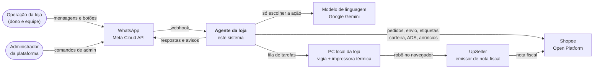
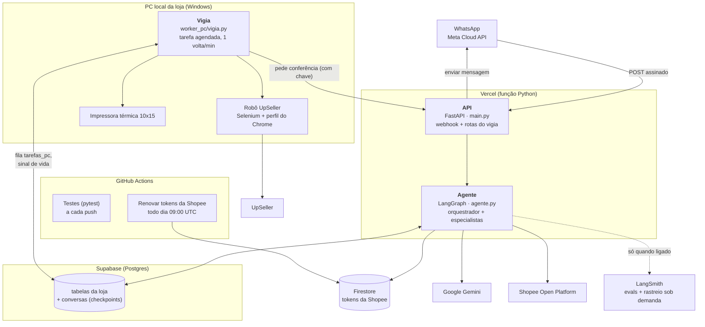
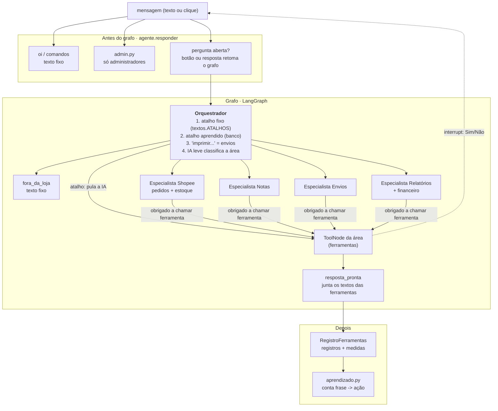
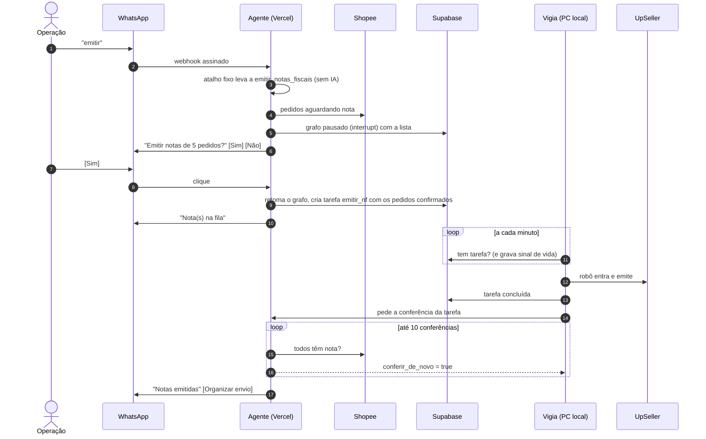
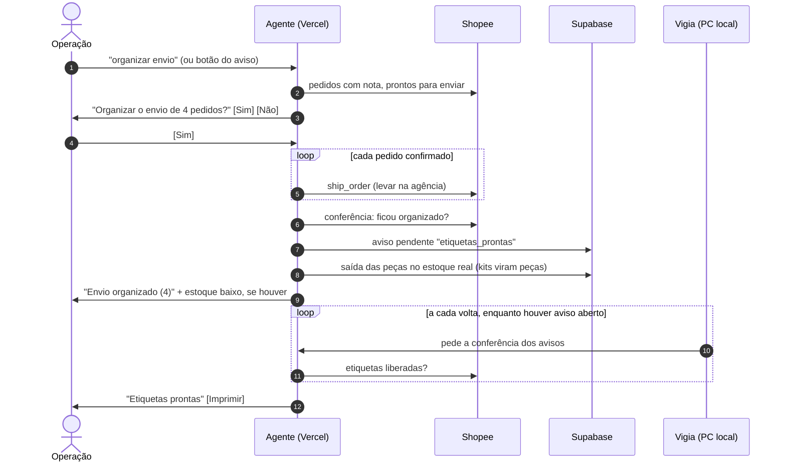
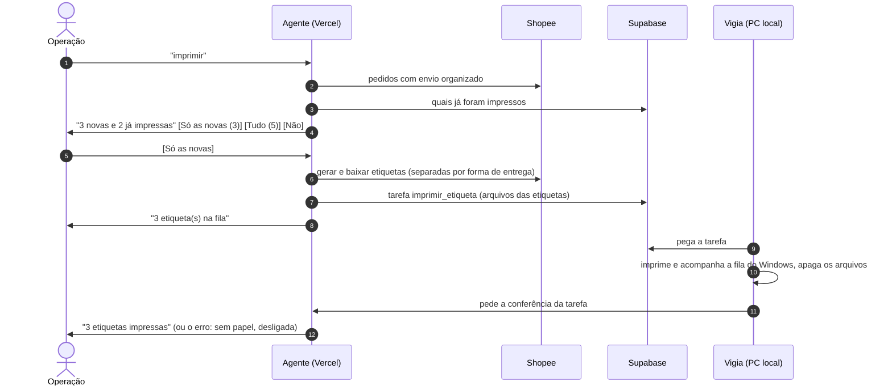
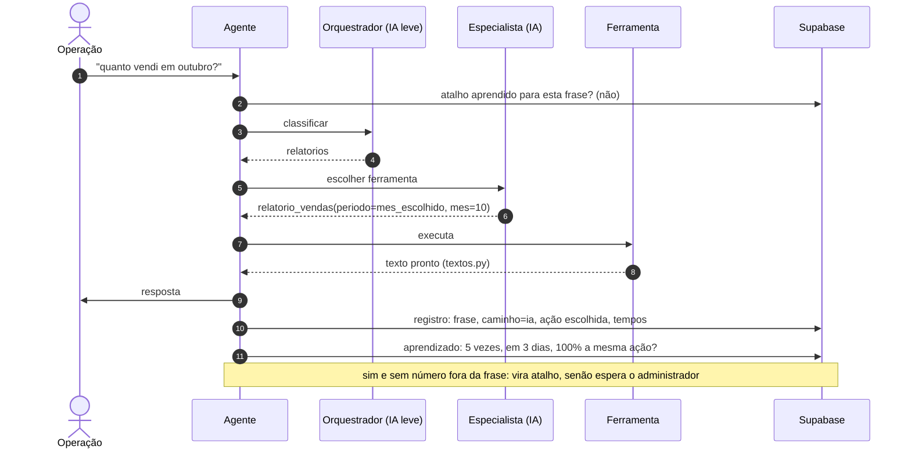

# Documento de arquitetura: agente de operação da loja pelo WhatsApp

| | |
|---|---|
| Situação | Em produção numa loja de semijoias da Shopee, revisão 1 |
| Autor | Leonardo P Sanches |
| Atualizado | 04/11/2026 |
| Leitura | Quem vai programar, manter ou avaliar o sistema |

Este documento explica **o que o sistema faz, como as partes conversam e por que foi feito
assim**. O código é privado (o sistema está em uso numa loja real) e pode ser mostrado numa
avaliação técnica. As decisões e os porquês estão em [decisoes.md](decisoes.md). O grafo gerado
do próprio código está em [grafo_agente.md](grafo_agente.md).

> Versão pública: sem o nome da loja e sem detalhes internos de segurança (rotas, nomes de
> chaves e variáveis).

> Os desenhos usam Mermaid: o GitHub desenha sozinho ao abrir o arquivo. Para editar, use o
> [mermaid.live](https://mermaid.live) ou a extensão de Markdown do VS Code.

---

## 1. Problema

Uma loja pequena da Shopee repete as mesmas tarefas todos os dias, em três sistemas diferentes:

1. **Emitir as notas fiscais** dos pedidos pagos (no emissor UpSeller, que não tem API).
2. **Organizar o envio** na Shopee depois que a nota sobe.
3. **Imprimir as etiquetas** 10x15 numa impressora térmica.
4. **Acompanhar a loja**: vendas, lucro, carteira, anúncios (ADS), saúde da conta e o estoque
   real das peças, que a Shopee não controla (kits usam várias peças; o estoque dos anúncios não é
   o estoque físico).

Cada tarefa exige abrir um painel, filtrar, clicar e conferir. O objetivo é que a pessoa da
operação faça tudo **por mensagem no WhatsApp**, em português do dia a dia, com segurança: nada
que mexa no mundo real acontece sem um "sim".

## 2. Requisitos

### Funcionais

| # | O sistema deve | Onde |
|---|---|---|
| F1 | Emitir as notas fiscais de todos os pedidos pendentes, com confirmação | `tools_notas.py`, `worker_nf/` |
| F2 | Organizar o envio (levar na agência) dos pedidos com nota e dar baixa no estoque real | `tools_envios.py`, `tools_estoque.py` |
| F3 | Imprimir etiquetas: novas, segunda via, pedidos citados ou os N últimos | `tools_envios.py`, `worker_pc/` |
| F4 | Avisar quando uma tarefa termina (notas na Shopee, etiquetas liberadas, impressão feita) | `avisos.py` |
| F5 | Responder relatórios: vendas, mais vendidos, situação dos pedidos, lucro, carteira, ADS, saúde | `tools_relatorios.py`, `tools_financeiro.py` |
| F6 | Controlar o estoque real: consultar, lançar entrada, acertar pela contagem, zerar ou voltar a vender na Shopee | `tools_estoque.py`, `estoque.py` |
| F7 | Dar ao administrador da plataforma: desempenho, erros e o que o agente aprendeu | `admin.py` |
| F8 | Aprender sozinho as frases que a IA sempre entende do mesmo jeito | `aprendizado.py` |

### Não funcionais

| # | Requisito | Como é atendido |
|---|---|---|
| N1 | **Segurança das ações**: nada muda na Shopee, na UpSeller, no estoque ou na impressora sem confirmação | `interrupt` do LangGraph + botões Sim/Não; a ação usa a lista que a pessoa viu |
| N2 | **Sem alucinação na resposta**: o texto enviado é sempre verdadeiro | A IA não escreve texto; todo texto vem de `textos.py` preenchido pela ferramenta |
| N3 | **Acesso só para quem é da loja** | Tabela `usuarios_autorizados`; número de fora é ignorado |
| N4 | **Mensagem processada uma vez só** (a Meta reenvia) | Tabela `mensagens_processadas` (id da mensagem) |
| N5 | **Só a Meta fala com o webhook** | Assinatura HMAC `X-Hub-Signature-256` conferida; falha fechada |
| N6 | **Resposta rápida e barata** | Frases prontas e aprendidas não chamam a IA; o orquestrador usa modelo leve |
| N7 | **Resiliência a falhas do provedor de IA** | Fila de modelos com reserva (`with_fallbacks`) |
| N8 | **Medível** | Cada resposta grava caminho e tempo de cada etapa; evals com frases reais |
| N9 | **Várias lojas** (preparado, ainda com uma) | `loja_id` em todas as tabelas e na conversa; ver limites aceitos (seção 12) |

## 3. Contexto (C4, nível 1)

Quem usa o sistema e com quem ele conversa.

- **Operação**: quem trabalha na loja. Manda frases livres ("vendas de outubro") ou comandos
  curtos ("emitir", "imprimir") e responde com botões.
- **Administrador da plataforma**: quem mantém o agente. Tem comandos extras (desempenho, erros,
  aprendizado), liberados só para uma lista de números guardada fora do banco.
- **PC local**: um computador Windows qualquer da loja, ligado à impressora térmica. Ele existe
  porque a UpSeller não tem API e recusa login vindo de servidores (ver ADR-005).

## 4. Contêineres (C4, nível 2)

O que roda, onde roda e como as partes se falam.

| Contêiner | Tecnologia | Responsabilidade | Estado |
|---|---|---|---|
| API | FastAPI no Vercel | Recebe o webhook, confere assinatura e remetente, chama o agente, envia a resposta, atende o vigia | Sem estado (tudo no banco) |
| Agente | LangGraph + LangChain | Decide o caminho da mensagem e executa as ferramentas | Conversa salva no Postgres (`PostgresSaver`) |
| Banco | Supabase Postgres | Lojas, usuários, fila do PC, avisos, registros, cópia dos pedidos, estoque, frases aprendidas, checkpoints | Fonte da verdade do agente |
| Tokens | Firestore | `access_token` e `refresh_token` da Shopee por loja | Renovados pelo agente e pelo Actions |
| Vigia | Python no Windows (tarefa agendada) | Atende a fila: emitir notas (robô) e imprimir etiquetas; grava sinal de vida | Perfil do Chrome em disco |
| Actions | GitHub | Testes a cada push; renovação diária dos tokens | Nenhum |
| LangSmith | SaaS | Dataset e resultado das evals; rastreio de produção desligado por padrão | 14 dias |

**Detalhe importante do Vercel**: a função é congelada assim que responde. Por isso todo o
atendimento acontece **antes** de devolver 200 à Meta (sem tarefas em segundo plano). Avisos
que dependem de tempo (a Shopee liberar a etiqueta minutos depois) são disparados pelo vigia,
que chama a API a cada volta (seção 6.2).

## 5. Componentes do agente (C4, nível 3)

Dentro do contêiner "Agente". O desenho gerado do código está em [grafo_agente.md](grafo_agente.md).

| Componente | Arquivo | Faz | Usa IA? |
|---|---|---|---|
| Entrada e saída do WhatsApp | `main.py` | Assinatura, remetente autorizado, repetição, botões, quebra de texto longo | Não |
| Respostas fixas | `agente.responder`, `textos.py` | "oi" (com o nome), "comandos" | Não |
| Comandos do administrador | `admin.py` | desempenho, erros, aprendizado, esquecer/liberar frase | Não |
| Orquestrador | `agente.orquestrador` | Escolhe a área ou a ferramenta | Só se a frase não for atalho |
| Especialistas | `agente.especialista` | Escolhem a ferramenta e os argumentos; nunca respondem em texto | Sim (`tool_choice="any"`) |
| Ferramentas | `tools_*.py` | Consultam ou agem e devolvem o texto final | Não |
| Textos | `textos.py` | Todo texto que sai para o WhatsApp, atalhos e palavras de resposta | Não |
| Aprendizado | `aprendizado.py` | Promove frase a atalho quando a IA acertou sempre | Não |
| Avisos | `avisos.py` | Confere resultado das tarefas do PC e avisa com botões | Não |
| Registro e medidas | `agente.RegistroFerramentas` | Grava respostas das ferramentas, erros, tempos | Não |
| Estoque | `estoque.py`, `tools_estoque.py` | Peças, composição dos kits, movimentos, estoque baixo | Não |

## 6. Caminho de uma mensagem

A ordem importa: **quanto mais cedo a mensagem é resolvida, menos IA ela usa**.

| Ordem | Caminho (`caminho` nas medidas) | Quando | IA |
|---|---|---|---|
| 1 | `fixo` | "oi", "comandos" | 0 chamadas |
| 2 | `admin` | Comando do administrador | 0 |
| 3 | `botao` / `resposta` | Há pergunta aberta e a pessoa clicou ou escreveu "sim", "não", "só as novas"... | 0 |
| 4 | `fixo` | A frase inteira é um atalho (`textos.ATALHOS`, ex.: "organizar envio") | 0 |
| 5 | `aprendido` | A frase virou atalho pelo aprendizado | 0 |
| 6 | `imprimir` | Começa com "imprim"/"reimprim": vai direto ao especialista de envios | 1 |
| 7 | `ia` | Qualquer outra frase | 2 (orquestrador + especialista) |

Com uma pergunta aberta, uma frase que não é resposta **cancela a pergunta** e vale como pedido
novo (ex.: "imprime só a do último" no lugar de clicar em "Só as novas").

### 6.1 Emitir notas fiscais

Proteções: se a lista mudou entre a pergunta e o "sim", pergunta de novo; só uma emissão por vez
por loja; se o vigia está sem sinal de vida, a resposta já avisa que o PC está parado.

### 6.2 Organizar envio e aviso de etiquetas

Organizar envio **não imprime**: a impressão é um pedido separado (ADR-007). Um erro na baixa do
estoque não desfaz o envio; vai na lista de problemas da resposta.

### 6.3 Imprimir etiquetas

### 6.4 Frase livre pela IA e aprendizado

## 7. Contrato das ferramentas

A parte mais importante de um agente: **o que cada ferramenta recebe, devolve e pode mudar**.
Todas recebem a loja pelo contexto (`config`), nunca pela IA, e devolvem o texto final pronto.

| Ferramenta | Área | Entrada (a IA preenche) | Devolve | Muda o mundo real? | Confirmação |
|---|---|---|---|---|---|
| `consultar_pedidos` | Shopee | `status` (READY_TO_SHIP, CANCELLED...), `dias` 1 a 15 | Quantos pedidos e os produtos somados | Não | Não |
| `consultar_estoque` | Shopee | `busca` (SKU ou nome), `so_acabando` | Estoque, entrou e saiu de cada peça | Não | Não |
| `lancar_entrada` | Shopee | `itens`: [{`peca`, `qtd` 1 a 10.000}], até 20 | Estoque novo de cada peça | **Sim**: movimentos de estoque | **Sim** |
| `acertar_contagem` | Shopee | `itens`: [{`peca`, `qtd` 0 a 10.000}] | Estoque acertado | **Sim**: movimento de contagem | **Sim** |
| `zerar_ou_voltar_na_shopee` | Shopee | `acao` (zerar, voltar), `pecas` | Quantas variações mudaram | **Sim**: estoque dos anúncios na Shopee (o real não muda) | **Sim** |
| `listar_pedidos_aguardando_nf` | Notas | nenhuma | Quantos sem nota e os produtos | Não | Não |
| `emitir_notas_fiscais` | Notas | nenhuma | "Na fila" ou motivo | **Sim**: notas na UpSeller (via PC local) | **Sim**, com a lista |
| `situacao_dos_envios` | Envios | nenhuma | Sem nota, prontos, a imprimir, impressas | Não | Não |
| `preparar_envio` | Envios | nenhuma | Quantos organizados, problemas, estoque baixo | **Sim**: envio na Shopee + saída no estoque | **Sim**, com a lista |
| `imprimir_etiquetas` | Envios | `pedidos` (números), `ultimos` N, `quais` (novas, segunda_via, tudo) | "Na fila" e problemas | **Sim**: impressão no PC local | **Sim**, com botões de opção |
| `relatorio_vendas` | Relatórios | `periodo`, `mes`, `ano`, `dias` | Pedidos, faturamento, líquido, ticket, comparação | Não | Não |
| `produtos_mais_vendidos` | Relatórios | `periodo`... + `quantidade` 1 a 20 | Ranking em peças | Não | Não |
| `pedidos_por_situacao` | Relatórios | nenhuma | Aguardando nota, a enviar, enviados | Não | Não |
| `lucro` | Relatórios | `periodo`... | Líquido menos custo das peças, embalagem e ADS | Não | Não |
| `carteira` | Relatórios | `periodo`... | Saldo, a receber, entradas e saídas | Não | Não |
| `anuncios_ads` | Relatórios | `periodo`... | Gasto, cliques, pedidos, retorno, saldo de ADS | Não | Não |
| `saude_da_loja` | Relatórios | nenhuma | Classificação e métricas com a meta | Não | Não |

`periodo` = hoje, ontem, semana, ultimos_dias, mes, mes_passado, mes_escolhido, ano,
ano_escolhido. Os limites (`ge`, `le`, `max_length`, padrão do número do pedido) estão nos
modelos Pydantic de cada ferramenta: argumento fora do limite é recusado antes de executar.

**Regras que valem para toda ferramenta que muda o mundo real**

1. Pede confirmação com `interrupt` mostrando **o que** vai mudar (quantidade e, quando cabe, a lista).
2. Age só sobre **o que a pessoa viu** na pergunta (os dados voltam junto com o "sim"); o que
   apareceu depois fica para a próxima.
3. Confere o resultado depois de agir (ex.: o envio ficou organizado?) e lista os problemas por pedido.
4. Nunca é chamada pela IA sem passar pelo especialista da área (a IA de uma área não vê as
   ferramentas das outras).

## 8. Onde a IA entra e onde não entra

| A IA faz | A IA não faz |
|---|---|
| Classificar a área de uma frase livre (orquestrador) | Escrever qualquer texto que a pessoa lê |
| Escolher a ferramenta e os argumentos (especialista) | Decidir se uma ação acontece (quem decide é o "sim") |
| | Ver a loja, o telefone ou o papel de quem fala como argumento (vêm do contexto) |
| | Responder sem ferramenta (é obrigada a chamar uma) |
| | Atender "oi", comandos, botões, atalhos e frases aprendidas |
| | Avisos, conferências e relatórios do administrador |

Consequência: o pior erro possível da IA é **escolher a ferramenta errada**, e as ferramentas
que agem sempre perguntam antes. Esse é o ponto que as evals medem (seção 11).

## 9. Dados

Supabase Postgres. Migrações numeradas em `banco/` (rodadas com `banco/criar_tabelas.py`).

| Tabela | Para quê | Migração |
|---|---|---|
| `lojas` | Cadastro da loja (id, nome, shop_id da Shopee) | 001 |
| `usuarios_autorizados` | Quem pode falar com o agente, de qual loja, com qual papel | 001 |
| `mensagens_processadas` | Id de cada mensagem da Meta, para não atender duas vezes | 001 |
| `tarefas_pc` | Fila do PC local: `emitir_nf`, `imprimir_etiqueta` (status, dados, erro, aviso) | 001 |
| `sessoes_robo` | Sessão da UpSeller usada nos testes pelo Actions | 002 |
| `registros` | Tudo o que entrou e saiu: mensagem, resposta, ferramenta, erro, medidas (`detalhe` jsonb) | 003 |
| `pedidos`, `pedidos_sincronizacao` | Cópia dos pedidos da Shopee para relatórios rápidos | 003 |
| `vigia_sinais` | Último sinal de vida do PC local | 004 |
| `avisos_pendentes` | Avisos que esperam a Shopee (ex.: etiquetas liberadas) | 005 |
| `pecas`, `movimentos_estoque` | Estoque real: peças, custo, mínimo de aviso; entradas e saídas (estoque = entradas - saídas) | 006 |
| `atalhos_aprendidos` | Frase -> ação, situação (ativo, com a IA), quem decidiu, uso | 007 |
| checkpoints do LangGraph | Conversa e pergunta aberta, por `loja:telefone` | criadas pelo `PostgresSaver` |

Fora do Postgres: tokens da Shopee no Firestore; segredos (Meta, Shopee, Gemini, banco, chave
do vigia) só em variáveis de ambiente do Vercel e no `.env` local, nunca no Git.

## 10. Segurança, riscos e proteções

| Risco | O que pode acontecer | Proteção |
|---|---|---|
| Alucinação na resposta | Agente diz que fez algo que não fez | IA não escreve texto; especialista obrigado a chamar ferramenta (incidente real, ver ADR-003) |
| Ação errada | Emitir, enviar ou imprimir sem querer | Confirmação com a lista; age só sobre o confirmado; frase que não é resposta cancela |
| Pessoa de fora | Estranho manda comandos | `usuarios_autorizados`; número de fora é ignorado sem resposta |
| Webhook falso | Alguém chama a API se passando pela Meta | HMAC com o App Secret; sem segredo configurado, recusa tudo |
| Vigia falso | Alguém chama as rotas do vigia | Chave própria no cabeçalho, comparada em tempo constante |
| Escalada para administrador | Cliente vira admin | A lista de administradores fica no ambiente, fora do banco |
| Reenvio da Meta | Mesma ação duas vezes | `mensagens_processadas`; uma emissão aberta por vez |
| Provedor de IA fora ou no limite | Mensagem sem resposta | Fila de modelos com reserva; atalhos não dependem da IA |
| PC local desligado | Tarefa parada sem ninguém saber | Tarefa espera na fila; sem sinal de vida, a resposta avisa |
| Dados pessoais | Nome e endereço do comprador vazarem | Arquivos de etiqueta apagados depois de imprimir; rastreio LangSmith desligado por padrão |
| Token da Shopee vencer | Agente perde acesso à loja | Renovação automática no uso + Actions diário que falha com e-mail |
| Aviso fora de hora | Aviso chega horas depois, sem contexto | Aviso com validade de 2 h |

## 11. Como medir

| O quê | Como | Onde |
|---|---|---|
| A IA escolhe certo? | 40 frases reais com a área, a ferramenta e os argumentos esperados | `evals/casos.json`, `python evals/rodar.py` (resultado no LangSmith) |
| Quanto passa sem IA? | `caminho` de cada resposta (fixo, aprendido, botão, ia...) | Tabela `registros`; `desempenho` no WhatsApp |
| Onde está o tempo? | `ia_ms`, `ferramentas_ms` (cada uma), `whatsapp_ms`, `total_ms` | Idem; `python evals/relatorio.py --dias 30` |
| Quais erros? | Linhas `erro` dos registros (ferramenta, Meta, agente) | `erros` no WhatsApp |
| O que foi aprendido? | Frases ativas, divididas, em observação | `aprendizado` no WhatsApp |
| Uma mensagem por dentro | Trace passo a passo | LangSmith, ligado só para investigar |
| Regressão do código | Testes de atalhos, aprendizado, estoque, etiquetas, Shopee | `pytest`, a cada push no Actions |

Resultados registrados (conferir antes de citar fora daqui):

| Data | Medida | Resultado |
|---|---|---|
| 29 e 30/10/2026 | Evals: rota / ferramenta / argumentos | 40/40 · 36/36 · 23/23 (depois da correção da rota de pedidos) |
| 30/10/2026 | Mensagens do dia atendidas sem IA | 100% |

## 12. Limites aceitos

Escolhas feitas de propósito para o tamanho atual da operação. Não são tarefas pendentes: cada
linha diz por que o limite é aceitável hoje e o que faria a decisão ser revista.

| Limite | Por que é aceitável hoje | O que faria rever |
|---|---|---|
| Uma loja só: as credenciais da Shopee vêm do ambiente (`tools_shopee.cliente_shopee`) | Tabelas e conversa já separam por `loja_id`; os tokens já ficam por loja no Firestore | Entrar uma segunda loja |
| Emissão de nota depende da tela da UpSeller (robô) | Não existe API; quando a tela muda, o erro volta como aviso no WhatsApp | Mudanças frequentes na tela ou um emissor com API |
| O agente não inicia conversa (ADR-008) | Avisar o resultado do que a pessoa pediu já cobre a operação | Precisar de notificação de algo que ninguém pediu |
| Devoluções não voltam sozinhas para o estoque real | São poucas; o acerto é feito com "contei N peças" | Volume de devoluções que torne o acerto manual pesado |
| Atendimento síncrono, antes do 200 à Meta (ADR-010) | Dezenas de mensagens por dia, respostas em segundos | Volume bem maior ou ferramentas lentas |

## 13. Glossário

| Termo | Significado |
|---|---|
| Orquestrador | Nó que decide para qual especialista a mensagem vai |
| Especialista | Nó com IA que só enxerga as ferramentas da sua área |
| Ferramenta (tool) | Função que consulta ou age e devolve o texto final |
| Atalho | Frase que vai direto para uma ferramenta, sem IA (fixo ou aprendido) |
| `interrupt` | Pausa do LangGraph para esperar a confirmação; a conversa fica salva no banco |
| Checkpoint | Estado salvo da conversa, por loja e telefone |
| Vigia | Programa no PC local que atende a fila de tarefas |
| Evals | Prova com frases reais que mede se a IA escolhe a área, a ferramenta e os argumentos certos |
| ADR | Registro de decisão de arquitetura: contexto, decisão e consequências |
