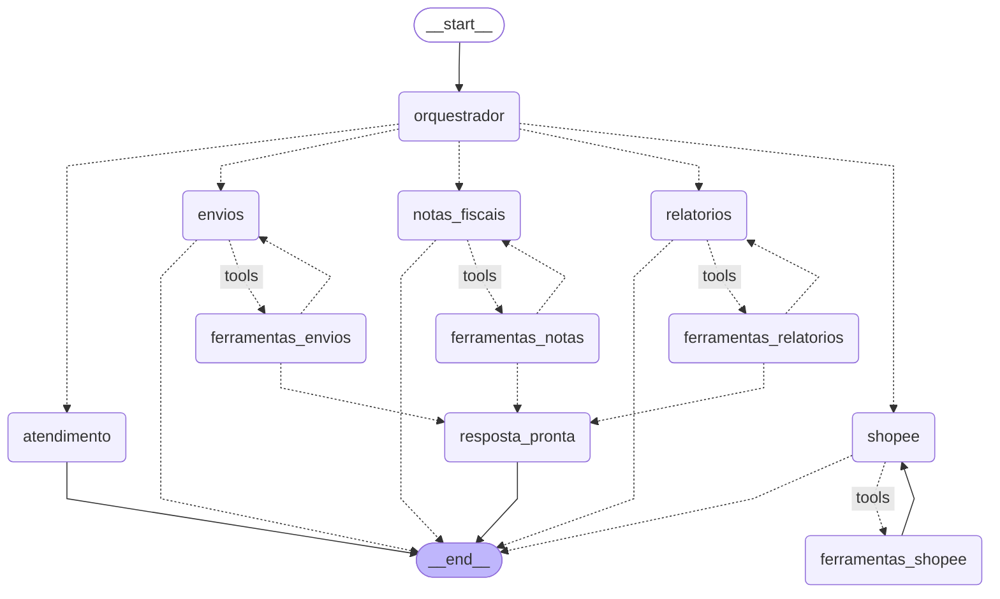

# Grafo do agente (LangGraph)

Desenho gerado do próprio código (`agente.py`) com
`agente.construtor.compile().get_graph().draw_mermaid()`. O GitHub mostra como fluxograma.

- Linha cheia: caminho fixo. Linha pontilhada: caminho decidido na hora (o orquestrador escolhe o
  especialista; o especialista decide se usa ferramenta ou responde).
- Cada especialista só enxerga as ferramentas da área dele. Ações (emitir nota, preparar envio,
  imprimir etiqueta) pausam o grafo e pedem confirmação no WhatsApp (botões Sim/Não) antes de agir.
- `resposta_pronta`: ações e relatórios terminam com o texto pronto de `textos.py`, sem a IA reescrever.

